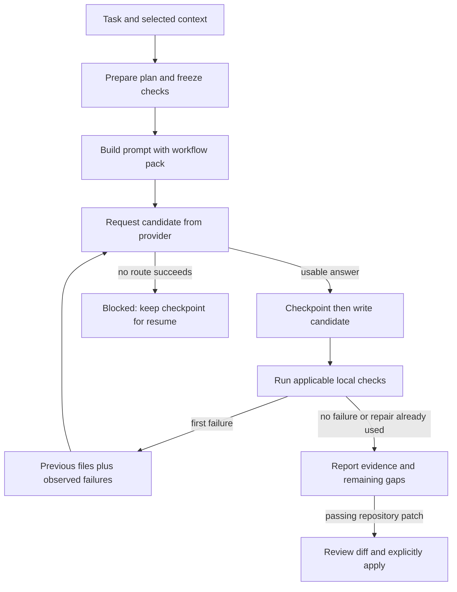

# Anatomy of a Karigat run

Karigat separates three jobs: the planner describes a solution, the builder proposes files, and local checks decide what actually worked. The planner and builder can use the same hosted model; they are roles, not persistent agents.

| Stage | What crosses the boundary | Where to look |
| --- | --- | --- |
| Intake | A free-form task, optional reference files and selected tracked sources from committed HEAD. `--auto-context` opts into source selection for upload. | [CLI](../src/karigat/cli.py), [project selection](../src/karigat/project.py) |
| Plan and checks | By default two requests run in parallel: a short implementation plan and an independent check design. Only the plan enters the first build prompt. `--checks` supplies a frozen contract; `--quick` skips automatic design. A designer's journey description is text; an executable browser journey comes from `--journey`. | [Design](../src/karigat/design.py), [check contract](../src/karigat/evidence.py) |
| Build | The selected pack and shared behavior guidance ask for a JSON summary and complete text files. Provider failures try only explicitly permitted fallback routes. | [Prompt packs](../src/karigat/packs/), [adapters](../src/karigat/cloud.py) |
| Write | Karigat records the response and candidate path before writing. Standalone attempts get separate directories; repository attempts get detached worktrees. | [Journal](../src/karigat/journal.py), [workspace](../src/karigat/workspace.py) |
| Verify | Check syntax, frozen data assertions and HTML findings where applicable. `--verify` runs an approved command on trusted code; repository runs also record the baseline on the original revision. Browser checks use a fresh Chromium profile and can replay a frozen interaction sequence. | [Command runner](../src/karigat/runner.py), [browser runner](../src/karigat/browser.mjs) |
| Repair and review | On a failed check, send the preceding output and concrete failures back for **one** repair. Re-run checks and retain both candidates. `report` shows attempts; `diff` shows a repository patch. `apply` requires a passing patch, unchanged HEAD and a clean original tree. | [Run loop](../src/karigat/cli.py), [review and apply](../src/karigat/release.py) |

## Follow a real workflow: habit persistence

The prompt is `make a habit tracker`. Before seeing the output, the [habit journey](../evals/habit-journey.json) defines observable actions: enter **Evening walk**, add it, mark it complete, reload and check its state. The builder sees the task, not the selectors. Chromium runs the steps against the written page. If the entry control is off screen, that measurement can guide a repair. A successful reload check is evidence for persistence in that browser profile; it says nothing about cross-device sync.

One real pitfall: a page can have several habit cards. A selector that picks the first checkbox may toggle a different habit. Preserve the original run's verdict, then record a separate replay scoped to the intended card. Fixing a verifier and fixing an app are different results.

## When a run stops

- **Blocked:** no configured route returned a usable candidate. Resume the saved run ID when the route is available.
- **Interrupted after writing:** resume compares saved file contents before proceeding. A divergent partial write stops for inspection. [Recovery test](../tests/test_postwrite_resume.py).
- **Failed:** inspect the individual checks and both attempts before deciding what to change. A failed shell command and a missing executable are different findings.
- **Checks passed / unchecked:** read the checks themselves. Syntax, a screenshot or a zero exit code alone cannot establish the full user workflow.

The journal and candidate folders can contain task text, source and generated files. Public examples belong in `evals/` as synthetic prompts and checks; raw journals and personal workspaces stay local. See the [roadmap](../ROADMAP.md) for proofs that are still missing.
